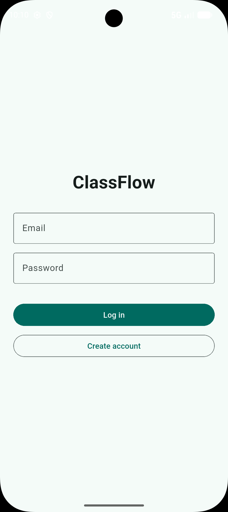
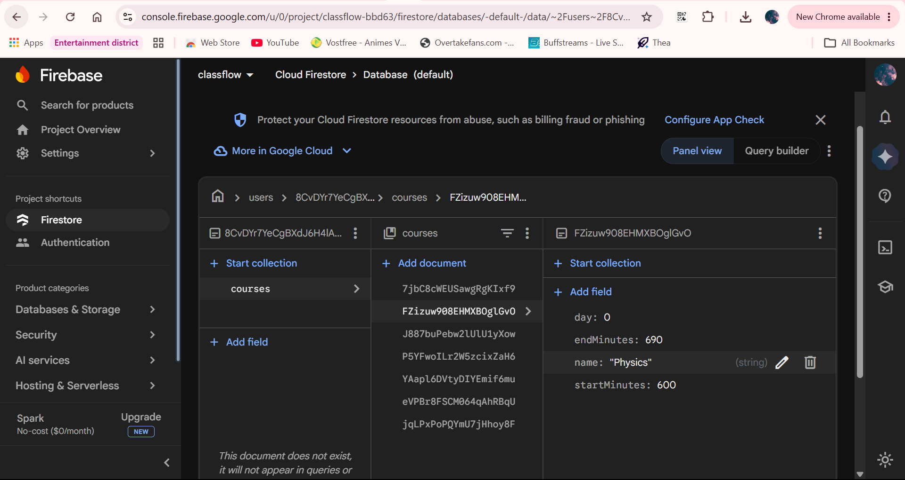
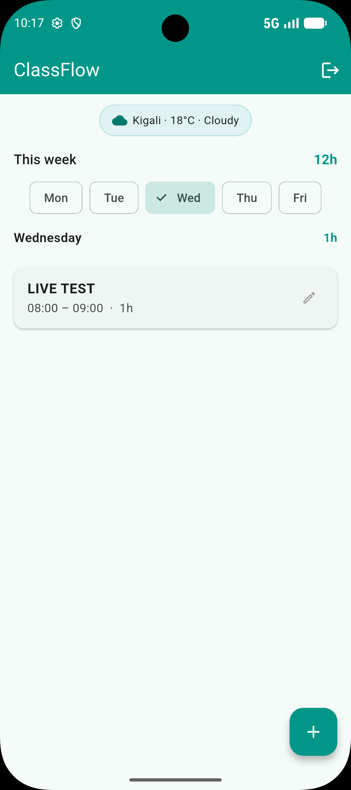
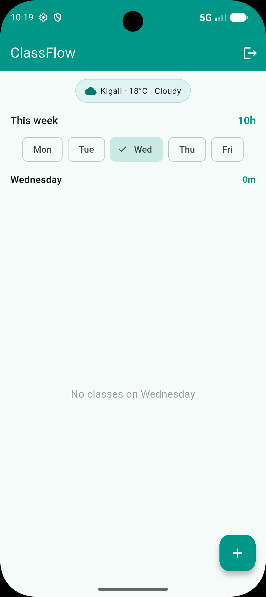

# ClassFlow

A weekly class timetable with clash detection, saved per user in Cloud Firestore. It signs users in with Firebase Authentication, and each user's data is saved in Cloud Firestore under their own id, so two accounts never see each other's data, and every change appears live.

## Features

- **Weekly timetable** — courses grouped by day (Mon–Fri), always sorted by start time
- **Totals** — each day's class time (`3h 30m`) and the week's total at the top
- **Clash detection** — two courses that overlap on the same day are flagged in red, naming the conflicting course
- **Add / edit / delete** — with full validation (`8h`, `25:00`, `10:75`, end-before-start all rejected)
- **Firebase login** — email/password sign-up and sign-in
- **Cloud sync** — every change is written to Firestore and updates live on every signed-in device
- **Per-user isolation** — Firestore rules ensure each account only reads/writes its own data

## Screenshots

## Think answers

**1. Write your clash condition in plain words. Why `<` and not `<=`?**

Two courses clash if they are on the same day, and each one starts before the other one ends. Using `<` (not `<=`) means back-to-back classes — one ending exactly when another begins — are **not** flagged. A student can walk from one room to the other, so it's not a conflict.

**2. Why is it easier to store times as minutes than as text like `08:30`?**

Because text can't be compared or subtracted reliably. `"8:30" < "10:00"` is false ("8" sorts after "1"), and `"08:30" - "08:00"` isn't defined. Storing `510` and `480` as integers gives me `<`, `-` (duration = 30), and `+` (total hours) with plain arithmetic. I only convert back to `HH:MM` at display time using `formatTime`.

## Built with

Flutter · Firebase Authentication · Cloud Firestore