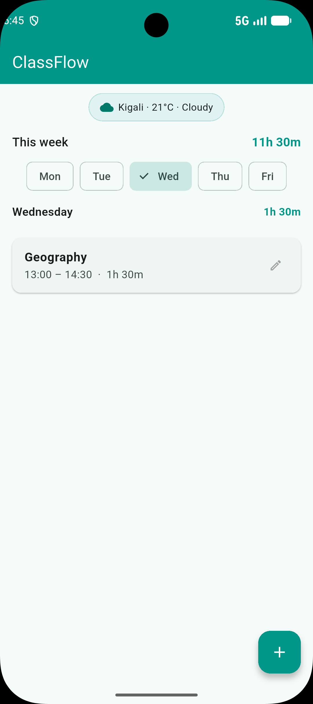
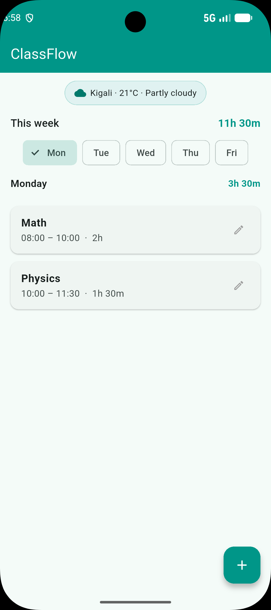

# ClassFlow

A weekly class timetable app that keeps your courses organised, warns you about clashes, and totals your hours.

My data is now saved on the phone with `shared_preferences`, so nothing is lost when the app closes, and it shows **live weather in Kigali** from the **Open-Meteo API**.

## The project

**My Week** — a weekly timetable with day chips, per-day and per-week totals, clash detection, and add/edit/delete flows.

## Features

- **Weekly timetable** — courses grouped by day (Mon–Fri), always sorted by start time.
- **Totals** — each day's class time (e.g. `3h 30m`) and the whole week's total at the top.
- **Clash detection** — two courses on the same day that overlap are flagged in red, naming the conflicting course. Courses that merely touch (e.g. one ends at 10:00, another starts at 10:00) are **not** flagged.
- **Add / edit / delete** — a second screen with full validation: name required, `HH:MM` format enforced, end time must be after start time, `8h` / `25:00` / `10:75` all rejected with a SnackBar.
- **Persistence** — every change is saved to disk; the app reopens exactly as you left it.
- **Live weather** — a small chip at the top shows Kigali's current temperature and sky, fetched from Open-Meteo, with a spinner while loading and a Retry button if offline.

## Screenshots

Before closing the app (a course I added is visible, and the week total reflects it):

After stopping the app and running it again — everything is still there:

Live data from the API (weather chip):

With Airplane mode on, the weather shows a clear error and a Retry button:

## Think answers

**1. Write your clash condition in plain words. Why `<` and not `<=`?**

Two courses clash if they are on the same day, and each one starts before the other one ends. I use `<` and not `<=` because when one course ends at exactly the moment another begins (say, 10:00), there is no actual overlap — the student can walk from one room to the other. Using `<=` would wrongly report back-to-back classes as conflicts. The strict `<` on both sides is what makes touching schedules safe.

**2. Why is it easier to store times as minutes than as text like `08:30`?**

Because text can't be compared or subtracted in a meaningful way. `"08:30" < "09:00"` happens to work by accident (character order), but `"8:30" < "10:00"` fails — `'8'` comes after `'1'` in the alphabet, so a single-digit hour sorts wrong. And `"08:30" - "08:00"` isn't a defined operation at all. Storing `startMinutes` and `endMinutes` as integers (e.g. `510` and `480`) gives values I can compare with `<`, subtract to get durations (`510 - 480 == 30`), and add to compute totals — all with plain arithmetic. I only convert back to `HH:MM` text at the moment of display, using `formatTime`.

## Built with

Flutter, `shared_preferences` for local storage, `http` + the Open-Meteo API for live weather.