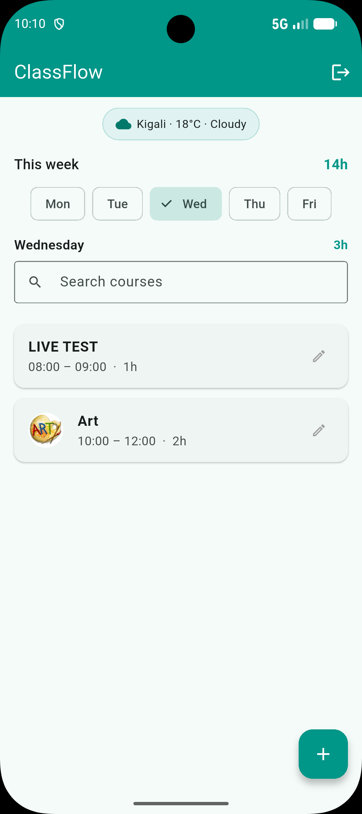
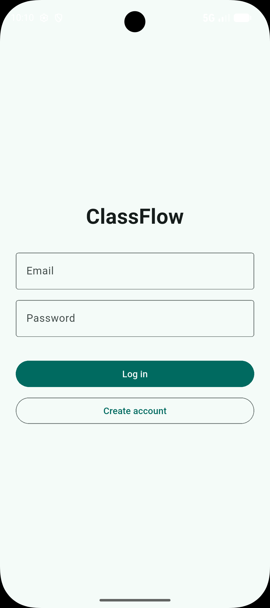
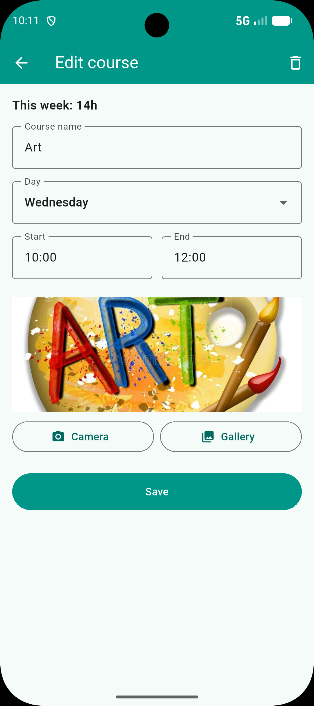

# ClassFlow

A weekly class timetable app that saves your courses in the cloud, detects schedule clashes, and shows live weather.

## Download
[Download the latest APK](https://github.com/4ri3ll4/classflow/releases/latest) (for Android phones)

## Features
- Firebase Authentication (login/signup)
- Live cloud sync: add, edit, and delete courses, and see them instantly on any device
- Clash detection: overlapping courses are highlighted in red
- Photo attachments: snap a picture of your classroom or textbook
- Search and filter by day or course name
- Live Kigali weather widget

## Screenshots
| Login | Weekly Timetable | Add Course |
|---|---|---|
|  |  |  |

## How it's built
- **Flutter** with **Provider** for state management (4-layer architecture).
- **Firebase Authentication** & **Cloud Firestore** for the backend.
- **Cloudinary** for image hosting.
- **Open-Meteo API** for live weather.

## Run it yourself
1. Clone the repo and run `flutter pub get`.
2. Add your own `google-services.json` in `android/app/`.
3. Add your Cloudinary credentials in `lib/repositories/photo_repository.dart`.
4. `flutter run`

## Author
[RUREBWAYIRE AMPOZE Ariella](https://github.com/4ri3ll4)